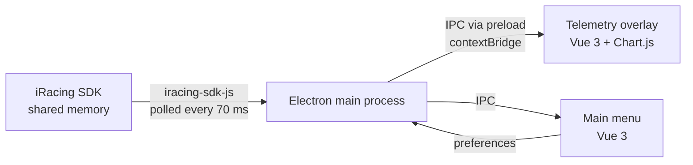

# open-overlay

A free, open-source telemetry overlay for iRacing. Shows live brake, throttle, and clutch traces, steering wheel angle, gear, and speed, in a transparent, always-on-top window that sits over the sim.

Built with Electron, Vue 3, and TypeScript.


## Features

- **Telemetry overlay:** live pedal input traces with numeric labels, steering wheel angle, gear, and speed
- **Click-through windows:** overlays stay on top of the sim without stealing mouse input
- **Repositionable:** press `Ctrl+Alt+Shift+M` to toggle drag mode, move the overlays where you want them, and press it again to lock them. Positions are saved automatically
- **Car-specific layouts:** detects which car you're driving and remembers your overlay positions for each one, so switching cars doesn't mean rearranging windows
- **System tray controls:** show or hide overlays, open the main menu (currently a drag-mode toggle, with more settings planned), or quit
- **Auto-updates:** installed builds update themselves from GitHub Releases

## Download

Grab the latest Windows installer from the [Releases page](https://github.com/dschykerynec/open-overlay/releases), run it, then start an iRacing session.

## How it works



- The **main process** reads telemetry from iRacing through [iracing-sdk-js](https://github.com/Friss/iracing-sdk-js) and pushes updates to each window over Electron IPC.
- Each **overlay window** is a separate Vue 3 app. A preload script exposes only the IPC channels it needs through `contextBridge`, with context isolation on.
- **User preferences** (per-car window positions, keybinds) live in a local `userPreferences.json` file that the main process loads at startup and writes on change.

### Why us [iracing-sdk-js](https://github.com/friss/iracing-sdk-js) to handle the data from iRacing?

This project grew out of my earlier [iRacing-SDKWrapper-Service](https://github.com/dschykerynec/iRacing-SDKWrapper-Service). The first version split the app into two parts: a .NET Windows service that read the SDK and streamed telemetry over WebSockets, and this app as a client. The goal was that front-end developers in any stack could build UIs from the same feed without learning a new language.

In practice, the extra network hop added noticeable latency, and for pedal and steering traces even small delays make the overlay feel out of sync with the car. I moved telemetry reading into the Electron main process and switched to IPC, which removed the network hop and the need to install and run a separate service. iracing-sdk-js works great and was super easy to learn. The performance is just as good as the C# monolith I built before adding the websocket layer, but building UIs is 1000x more fun with js/ts.

## Why does this exist?

I love sim racing, and my friends sometimes watch my races on Discord. I wanted a detailed telemetry overlay for them to see, but the popular commercial options charge a monthly fee close to the cost of iRacing itself. Open-source options like [iRon](https://github.com/lespalt/iRon) exist but haven't been updated in a while, so I built my own from scratch as a learning project.

This is primarily for my own use and learning, so updates come irregularly rather than on a release schedule.

## Development

**Requirements:** Windows, Node.js 22+, and iRacing (the SDK only provides data while a session is running).

```bash
npm install          # install dependencies
npm run dev          # run with hot reload
npm run typecheck    # type-check main and renderer code
npm run lint         # ESLint
npm run build:win    # build a Windows executable
```

### Publishing a release

Releases are built and published to GitHub with [Electron Forge](https://www.electronforge.io/). Copy `env.sample` to `.env`, fill in a GitHub token with `public_repo` scope plus the repository owner and name, then run:

```bash
npm run publish
```

## Roadmap

- [x] Telemetry overlay
- [x] Draggable windows with saved, per-car positions
- [x] Main menu window and system tray icon
- [ ] Configurable settings in the main menu (telemetry overlay options, keybinds)
- [ ] Relative window
- [ ] Standings window

## License

[GPL-3.0](LICENSE)

## Attributions

F1 steering wheel icon: [F1 icons created by Freepik - Flaticon](https://www.flaticon.com/free-icons/f1)
